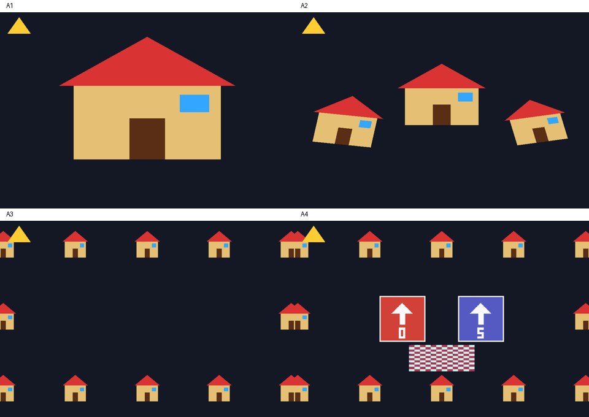

# 교사용 자료

- [정답 및 채점 안내](ANSWER_KEY.md): A1~A4 구현 해설, 설명 문제 모범 답안, 채점 확인 항목
- `../solutions/a1`~`../solutions/a4`: 실행 가능한 참고 구현

학생 배포 시 `teacher`와 `solutions` 폴더를 제외한다. 정답 코드는 루트의 `build.bat solutions 번호 run`으로 실행한다.

## 출력 예시



## 검증

A1~A4 Debug 빌드와 각 프로그램 3회 화면 갱신을 확인했다. OpenGL 오류 없이 종료되었으며 기본 출력 화면을 captures에 저장했다.

추가 검사는 다음 명령으로 실행한다. 먼저 위의 정답 빌드를 한 번 수행해야 한다.

```bat
cmake --build build-solutions --config Debug --target verify_solutions
build-solutions\Debug\verify_solutions.exe
```

검사 범위는 TRS/RTS 수치 결과, 카메라 중심과 NDC 범위, 회전 카메라의 클릭 좌표 역변환, 아틀라스 UV, 이동·초기화 입력, 줌 제한, 네 가지 필터/wrap 설정 조합이다. 키보드의 모든 조합이나 실제 창 크기 변경을 자동 재현하는 검사는 아니므로 수업 전 조작은 정답 및 채점 안내의 확인 항목을 따라 점검한다.
